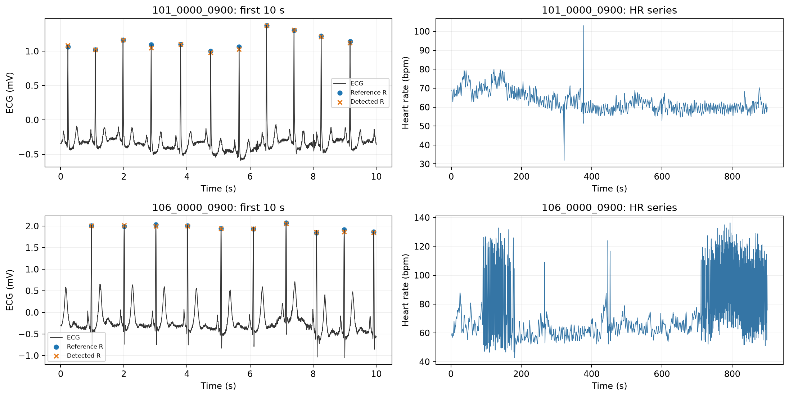
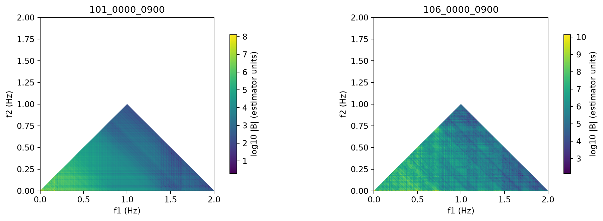
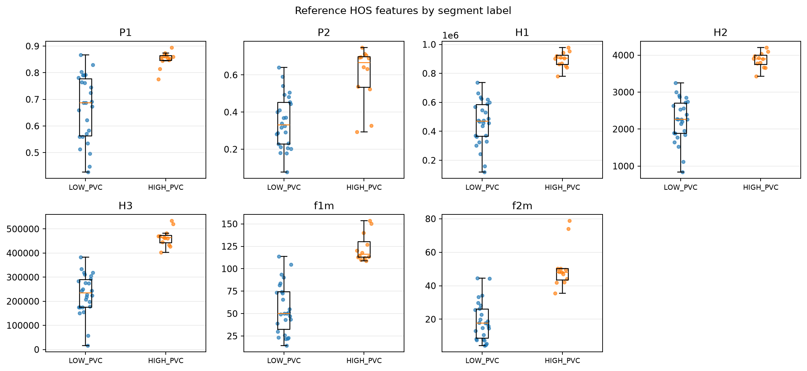
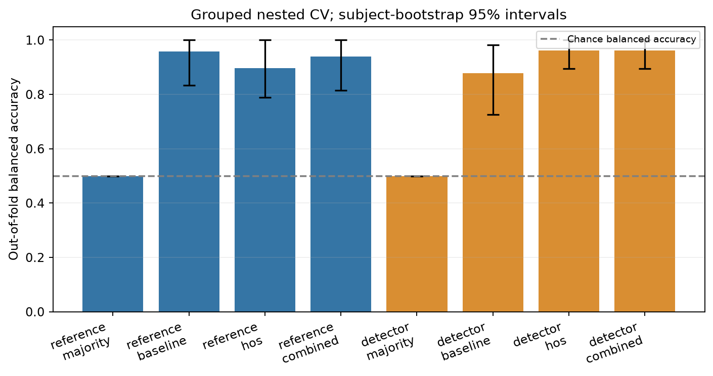
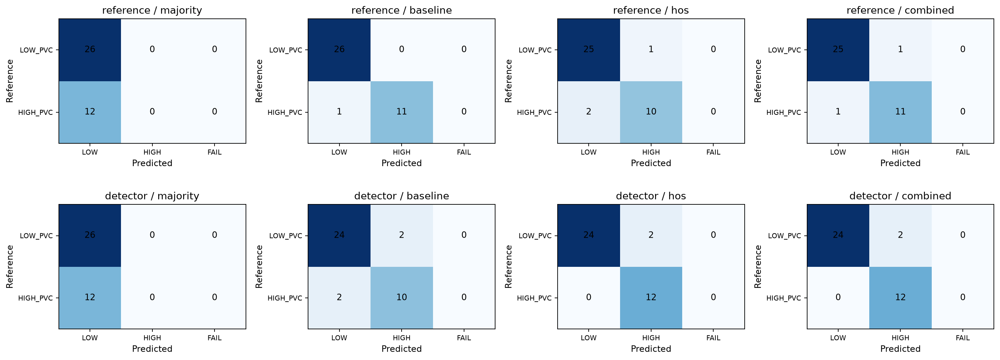

# گزارش طبقه‌بندی بار PVC با ویژگی‌های HOS

پروتکل: `mitdb_pvc_v1`. این گزارش از فایل‌های همین اجرا ساخته شده است؛ اجرای گزارش‌ساز مدل را آموزش نمی‌دهد.

## پرسش و تعریف خروجی

هدف، بررسی تفکیک قطعات 15 دقیقه‌ای با بار کم و زیاد ضربان زودرس بطنی در افراد خارج از آموزش است. این آزمایش تشخیص پنج بیماری مقالهٔ اصلی یا تشخیص بالینی نیست.

| برچسب | تعریف عملیاتی |
| --- | --- |
| `LOW_PVC` | نسبت ضربان‌های V به همهٔ ضربان‌های معتبر حداکثر 1.0% |
| `HIGH_PVC` | نسبت ضربان‌های V به همهٔ ضربان‌های معتبر حداقل 5.0% |

قطعات با بار بیشتر از 1.0% و کمتر از 5.0% حذف می‌شوند. تعداد و درصد PVC فقط برای ساخت برچسب است و ورودی مدل نیست. LOW_PVC به معنی فرد سالم نیست؛ این آستانه‌ها معیار تشخیص پزشکی نیستند.

## داده و ممیزی

دادهٔ ورودی: [MIT-BIH Arrhythmia Database 1.0.0](https://physionet.org/content/mitdb/1.0.0/). فایل‌های خام در مخزن کد قرار نمی‌گیرند. هش و نسخهٔ داده، همراه فایل‌های آماده‌سازی اجرا نگهداری می‌شود.

| شاخص | تعداد |
| --- | --- |
| قطعات بررسی‌شده | 96 |
| قطعات پذیرفته‌شده | 38 |
| قطعات حذف‌شده | 58 |
| افراد پذیرفته‌شده | 22 |

| کلاس | قطعه | فرد |
| --- | --- | --- |
| LOW_PVC | 26 | 15 |
| HIGH_PVC | 12 | 7 |

علت‌های حذف ممکن است هم‌زمان برای یک قطعه ثبت شده باشند:

| علت ثبت‌شده | تعداد |
| --- | --- |
| beat_purity | 28 |
| intermediate_pvc_burden | 15 |
| paced_record | 8 |
| rhythm_coverage | 23 |

نشانه‌های غیرضربان در حاشیه‌نویسی قطعات بررسی‌شده در جدول زیر جمع شده‌اند. همهٔ این کدها الزاماً نشانهٔ کیفیت پایین نیستند؛ برای نمونه، کد تغییر ریتم هم غیرضربان است. وجود آن‌ها به‌تنهایی قاعدهٔ حذف جدید ایجاد نمی‌کند و جزئیات هر قطعه در cohort.csv باقی می‌ماند.

| کد حاشیه‌نویسی | تعداد |
| --- | --- |
| `!` | 472 |
| `"` | 437 |
| `+` | 1171 |
| `[` | 6 |
| `]` | 6 |
| `x` | 192 |
| `\|` | 131 |
| `~` | 572 |

رکوردهای کنارگذاشته‌شده: 102, 104, 107, 217. رکوردهای ۲۰۱ و ۲۰۲ یک فرد محسوب می‌شوند. قطعات بدون هم‌پوشانی از کانال MLII بررسی می‌شوند. قواعد پذیرش شامل سهم حداقل 99.0% ضربان‌های مجاز و سهم حداقل 95.0% ریتم‌های مجاز است. جزئیات علت حذف در cohort.csv ثبت می‌شود.

## استخراج ویژگی و پوشش پردازش

مسیر reference از زمان ضربان‌های حاشیه‌نویسی متخصصان استفاده می‌کند و آزمایش اصلیِ ویژگی‌ها است. مسیر detector از ECG خام، بازنمونه‌برداری، فیلتر و آشکارساز R استفاده می‌کند و خطای زنجیرهٔ کاربردی را هم شامل می‌شود. آشکارسازی روی رکورد کامل انجام می‌شود.

در هر مسیر RR برحسب ثانیه و HR=60/RR ساخته و بدون برون‌یابی به سری یکنواخت تبدیل می‌شود. ضربان نابجای واقعی حذف نمی‌شود. بای‌اسپکتروم با میانگین‌گیری بلوک‌ها محاسبه می‌شود؛ حداقل 5 بلوک معتبر برای هر قطعه لازم است. یک قطعه فقط یک بردار ویژگی می‌دهد و بلوک‌های داخلی نمونه‌های مستقل نیستند.

ویژگی‌های HOS عبارت‌اند از P1، P2، H1، H2، H3، f1m و f2m. مجموعهٔ ساده شامل mean_rr، sd_rr، rmssd_rr، prr50، توان لگاریتمی VLF/LF/HF و آنتروپی طیف توان است. این شاخص‌ها از فاصلهٔ تمام ضربان‌ها ساخته می‌شوند و نباید به‌عنوان HRV صرفاً مبتنی بر ضربان‌های نرمال یا شاخص قطعی عملکرد دستگاه عصبی خودمختار تفسیر شوند.

تنظیمات پردازش زیر مقادیر ثبت‌شده در paper_config.json یا extraction.json هستند. مواردی مانند پنجره، پایهٔ لگاریتم و مقیاس FFT از ابهام‌های پیاده‌سازی مقاله‌اند و انتخاب این آزمایش محسوب می‌شوند.

| پارامتر | مقدار |
| --- | --- |
| نرخ هدف ECG (Hz) | 320.0 |
| نرخ سری ضربان (Hz) | 4.0 |
| اندازهٔ بلوک / NFFT | 1024 |
| هم‌پوشانی نمونه‌ها | 512 |
| پنجره | hann |
| درون‌یابی | linear |
| حذف میانگین بلوک | فعال |
| مقیاس FFT | raw |
| پایهٔ لگاریتم | e |
| کف دامنه برای لگاریتم | 1e-12 |
| نرمال‌سازی آنتروپی | فعال |
| حضور مؤلفهٔ DC | فعال |
| مبدأ شاخص H3 و مرکز وزنی | 1 |
| پایین‌گذر / بالاگذر (Hz) | 35.0 / 0.3 |
| مرتبهٔ فیلتر | 4 |
| ناچ detector (Hz) | 60 |
| ضریب کیفیت ناچ | 30.0 |
| عرض فیلتر میانه (s) | 0.6 |

مختصات ویژگی‌های f1m و f2m در پیاده‌سازی حاضر، شاخص خانهٔ FFT با مبدأ ثبت‌شده است؛ محور شکل بای‌اسپکتروم برای خوانایی برحسب Hz نمایش داده می‌شود و با واحد این دو ویژگی یکسان نیست.

| قاعدهٔ پروتکل | مقدار |
| --- | --- |
| ضربان‌های مجاز | N, L, R, V |
| ریتم‌های مجاز | (N, (B, (T, (SBR |
| بیشینهٔ خط صاف پیوسته (s) | 2.0 |
| حداقل بلوک در هر مسیر | 5 |
| حداقل فرد پذیرفته‌شده در هر کلاس | 5 |

| مسیر | قطعات ثبت‌شده | موفق | شکست | پوشش استخراج |
| --- | --- | --- | --- | --- |
| reference | 38 | 38 | 0 | 100.0% |
| detector | 38 | 38 | 0 | 100.0% |

تطبیق قله‌های آشکارساز با مرجع یک‌به‌یک و با تلورانس 150 میلی‌ثانیه است. شاخص‌های زیر از مجموع TP/FP/FN قطعات محاسبه شده‌اند:

| TP | FP | FN | حساسیت | ارزش اخباری مثبت | MAE زمانی |
| --- | --- | --- | --- | --- | --- |
| 40388 | 231 | 522 | 98.7% | 99.4% | 3.18 ms |

پنج قطعه با کمترین حساسیت آشکارسازی در میان قطعات دارای نتیجهٔ معتبر:

| قطعه | حساسیت | ارزش اخباری مثبت | TP | FP | FN | MAE زمانی |
| --- | --- | --- | --- | --- | --- | --- |
| 228_0000_0900 | 65.2% | 98.4% | 677 | 11 | 362 | 5.03 ms |
| 108_0900_1800 | 89.6% | 83.3% | 820 | 164 | 95 | 18.30 ms |
| 228_0900_1800 | 96.5% | 99.9% | 973 | 1 | 35 | 4.66 ms |
| 105_0900_1800 | 99.2% | 96.9% | 1304 | 42 | 11 | 4.56 ms |
| 214_0000_0900 | 99.7% | 100.0% | 1130 | 0 | 3 | 4.90 ms |

شاخص‌های تجمیعی خوب می‌توانند خطای زیاد در بعضی قطعات را پنهان کنند؛ جدول قطعات و فایل qrs_metrics.csv باید همراه مجموع‌ها بررسی شوند. بهتر بودن دقت طبقه‌بندی در مسیر آشکارساز نسبت به مسیر مرجع، به‌تنهایی نشانهٔ اندازه‌گیری دقیق‌تر ECG یا ضربان‌ها نیست؛ خطاهای آشکارساز نیز می‌توانند ویژگی‌ها و تصمیم مدل را تغییر دهند.

## ارزیابی طبقه‌بندی

وضعیت ثبت‌شده: `complete`.

یکپارچگی تنظیمات و هش‌های استخراج در ارزیابی: **تأیید شده**.

ارزیابی از اعتبارسنجی متقاطع تو‌در‌تو با 3 بخش بیرونی و 3 بخش درونی در سطح فرد استفاده می‌کند. استانداردسازی و انتخاب C/gamma فقط در آموزش انجام می‌شود. تمام قطعات یک فرد در یک بخش می‌مانند. مدل‌های اکثریت، ویژگی‌های ساده، HOS و ترکیبی از تقسیم‌های یکسان استفاده می‌کنند. بذر پایه 20261026 است و انتخاب تقسیم به عملکرد وابسته نیست.

برای بازه‌های اطمینان ۹۵٪، در صورت موجودبودن، 2000 بازنمونه‌گیری در سطح فرد درخواست شده است. بازنمونه‌هایی که هر دو کلاس را ندارند کنار گذاشته می‌شوند؛ تعداد قابل استفاده: 2000. این بازه‌ها عدم‌قطعیت همین پیش‌بینی‌های خارج از آموزش را توصیف می‌کنند. FAIL/ABSTAIN در ماتریس‌ها به معنی شکست زنجیره است؛ در ارزیابی سرتاسری پاسخ نادرست محسوب می‌شود و از مخرج حذف نمی‌شود.

| جمعیت ارزیابی | تعداد قطعه |
| --- | --- |
| قطعات پذیرفته‌شده در آماده‌سازی | 38 |
| قطعات با استخراج مرجع موفق؛ شاخص پوشش | 38 |
| قطعات با استخراج آشکارساز موفق؛ شاخص پوشش | 38 |

جمعیت اصلی ارزیابی شامل تمام قطعات پذیرفته‌شده پس از کنترل کیفیت داده است. شکست استخراج در هر یک از مسیرهای مرجع و آشکارساز، قطعه را از این جمعیت خارج نمی‌کند: آن مسیر برای قطعه ABSTAIN ثبت می‌کند و در معیارهای سرتاسری پاسخ نادرست محسوب می‌شود. تعداد استخراج‌های موفق فقط شاخص پوشش است و مخرج ارزیابی اصلی را تغییر نمی‌دهد.

| مسیر | مدل | دقت متوازن | بازهٔ ۹۵٪ | حساسیت HIGH | ویژگی LOW | F1 کلاس HIGH | پوشش |
| --- | --- | --- | --- | --- | --- | --- | --- |
| reference | کلاس اکثریت | 50.0% | 50.0% تا 50.0% | 0.0% | 100.0% | 0.0% | 100.0% |
| reference | ویژگی‌های ساده | 95.8% | 83.3% تا 100.0% | 91.7% | 100.0% | 95.7% | 100.0% |
| reference | هفت ویژگی HOS | 89.7% | 78.9% تا 100.0% | 83.3% | 96.2% | 87.0% | 100.0% |
| reference | ویژگی‌های ترکیبی | 93.9% | 81.4% تا 100.0% | 91.7% | 96.2% | 91.7% | 100.0% |
| detector | کلاس اکثریت | 50.0% | 50.0% تا 50.0% | 0.0% | 100.0% | 0.0% | 100.0% |
| detector | ویژگی‌های ساده | 87.8% | 72.6% تا 98.3% | 83.3% | 92.3% | 83.3% | 100.0% |
| detector | هفت ویژگی HOS | 96.2% | 89.5% تا 100.0% | 100.0% | 92.3% | 92.3% | 100.0% |
| detector | ویژگی‌های ترکیبی | 96.2% | 89.5% تا 100.0% | 100.0% | 92.3% | 92.3% | 100.0% |

اختلاف دقت متوازن HOS منهای ویژگی‌های ساده در مسیر `reference`: **-6.1 واحد درصد**؛ بازهٔ اطمینان: -19.9 تا 11.5 واحد درصد. این عدد باید همراه اندازهٔ نمونه و عدم‌قطعیت تفسیر شود.

اختلاف دقت متوازن HOS منهای ویژگی‌های ساده در مسیر `detector`: **8.3 واحد درصد**؛ بازهٔ اطمینان: 0.0 تا 21.4 واحد درصد. این عدد باید همراه اندازهٔ نمونه و عدم‌قطعیت تفسیر شود.

مقایسهٔ جفت‌شدهٔ دو مسیر فقط روی قطعات موفق مشترک انجام شده است و جایگزین ارزیابی سرتاسریِ شامل شکست‌ها نیست:

| مدل | قطعات مشترک | دقت متوازن مرجع | دقت متوازن آشکارساز |
| --- | --- | --- | --- |
| majority | 38 | 50.0% | 50.0% |
| baseline | 38 | 95.8% | 87.8% |
| hos | 38 | 89.7% | 96.2% |
| combined | 38 | 93.9% | 96.2% |

## نمودارها

## محدودیت‌ها و بازتولیدپذیری

این یک مطالعهٔ اکتشافی با افراد کم است. قطعات یک فرد مستقل نیستند؛ به همین دلیل تقسیم و بازنمونه‌گیری در سطح فرد انجام می‌شود. حاشیه‌نویسی مرجع با برچسب خروجی تفاوت دارد: زمان ضربان ورودی پردازش است، ولی کد نوع ضربان فقط برای ساخت برچسب قطعه استفاده می‌شود. هیچ شمارش PVC یا شناسهٔ فرد به مدل داده نمی‌شود.

برتری HOS تضمین نشده است. پایین‌بودن عملکرد یا نبود تفاوت با ویژگی‌های ساده، نتیجهٔ معتبر همین آزمایش است. از این نتایج نمی‌توان تشخیص بالینی، سازوکار فیزیولوژیک قطعی، یا تکرار نتایج مقالهٔ اصلی را نتیجه گرفت.

مصنوعی‌بودن هر اجرای آزمایشی باید از متادیتای همان اجرا تشخیص داده شود؛ فایل‌های آزمون نرم‌افزار نتیجهٔ بالینی محسوب نمی‌شوند. برای بازتولید، تنظیمات، نسخهٔ کد، هش ورودی‌ها، تقسیم افراد و پیش‌بینی هر قطعه را همراه این گزارش نگه دارید.

فایل‌های اصلی این اجرا:

- [audit.json](audit.json)
- [cohort_summary.csv](cohort_summary.csv)
- [accepted_segments.csv](accepted_segments.csv)
- [features_reference.csv](features_reference.csv)
- [features_detector.csv](features_detector.csv)
- [qrs_metrics.csv](qrs_metrics.csv)
- [evaluation.json](evaluation.json)
- [predictions.csv](predictions.csv)
- [splits.json](splits.json)
- [protocol.json](protocol.json)
- [paper_config.json](paper_config.json)
- [extraction.json](extraction.json)
- [source_files.json](source_files.json)
- [provenance.json](provenance.json)
